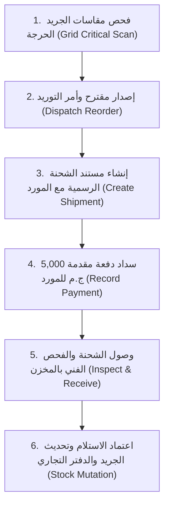

# خطة الاختبار التشغيلي الشامل — القالب الثاني (Template 2 Test Plan)
## طلب توريد خارجي لنواقص مصفوفة العدسات والشحن واستلام المخزون (Backorder & Restock)

---

## 📋 1. بطاقة تعريف السيناريو (Scenario Passport)

| المتغير | القيمة المحددة |
| :--- | :--- |
| **كود القالب** | `TEMPLATE-02` |
| **عنوان السيناريو** | طلب توريد خارجي لنواقص مصفوفة العدسات واستلام الشحنة وتحديث المخزون |
| **الهدف التشغيلي** | اختبار دورة المشتريات والتوريد الكاملة: رصد نواقص الجريد، إنشاء أمر التوريد، سداد دفعة مقدمة للمورد، استلام الشحنة بالمخزن، وتحديث مصفوفة المقاسات والدفتر التجاري |
| **الفرع المنفذ** | فرع الدقي الرئيسي (`OPT-MAIN`) |
| **المورد المستهدف** | شركة إيسيلور إيجيبت للتوريدات البصرية (`SUP-ESSILOR-01` / Essilor Egypt) |
| **المسؤول المنفذ** | أسامة محمود الشاذلي (مدير الفرع والمشتريات - `manager.dokki@optics.local`) والمحاسب طارق النجار (`accountant@optics.local`) |
| **الخادم وقاعدة البيانات** | `http://localhost:5005` \| `mongodb://localhost:27017/optics_store_system` |

---

## 👥 2. أطراف ومسؤولو العملية (Actors & Credentials)

1. **مدير الفرع والمشتريات (Purchasing Officer):**
   - **الاسم:** أسامة محمود الشاذلي
   - **الحساب:** `manager.dokki@optics.local`
   - **كلمة المرور:** `Manager@2026!`
   - **الصلاحية:** مدير فرع (Role 4)
   - **الدور:** فحص المخزون الحرج، اعتماد مقترح التوريد، وإرسال أمر الشراء للمورد.
2. **المورد المعتمد (Authorized Supplier):**
   - **الاسم التجاري:** شركة إيسيلور إيجيبت للتوريدات البصرية (Essilor International Egypt)
   - **كود المورد:** `SUP-ESSILOR-01`
   - **المسؤول:** م. سمير عثمان (مدير المبيعات والتوزيع)
   - **العملة المعتمدة:** الجنيه المصري (EGP)
3. **أمين المخزن والمحاسب (Receiving & Finance Staff):**
   - **الاسم:** أ. طارق عبد الحميد النجار
   - **الحساب:** `accountant@optics.local`
   - **كلمة المرور:** `Accountant@2026!`
   - **الصلاحية:** محاسب ومسؤول مالي (Role 4)
   - **الدور:** تسجيل إيصال سداد دفعة المورد، فحص الشحنة عند الوصول، واستلام البضاعة وتغذية الجريد.

---

## 📦 3. الأصناف المطلوبة للتوريد ومصفوفة المقاسات

### الصنف 1: عدسات بلو كت عاكسة للأشعة الزرقاء (Blue Cut 1.56 Lenses)
* **سبب التوريد:** سحب المخزون في العملية السابقة وتناقص الخلايا الحرجة.
* **الكمية الإجمالية المطلوبة:** 20 حبة (10 أزواج).
* **تفاصيل المقاسات بمصفوفة الجريد (Matrix Power Allocations):**
  - مقاس `SPH: -2.00 / CYL: -0.50`: 10 حبات (5 أزواج) @ 110.00 ج.م = 1,100.00 ج.م.
  - مقاس `SPH: -1.75 / CYL: -0.50`: 10 حبات (5 أزواج) @ 110.00 ج.م = 1,100.00 ج.م.
* **تكلفة شراء العدسات الأساسية:** 2,200.00 ج.م.

### الصنف 2: شنبر نظارة رايبان طيار أصلي (Ray-Ban Aviator RB3025)
* **الكمية المطلوبة:** 5 قطع.
* **سعر شراء الوحدة (Unit Cost):** 1,600.00 ج.م.
* **إجمالي تكلفة الشنابر الأساسية:** 5 * 1,600 = 8,000.00 ج.م.

---

## 💰 4. الخطة المالية ومصاريف الشحن وتكلفة الهبوط (Landed Cost & Payables)

1. **إجمالي تكلفة البضائع المشتراة (Goods Value):** `10,200.00 ج.م`.
2. **مصاريف الشحن والتأمين الداخلي (Inbound Freight & Courier):** `300.00 ج.م`.
3. **إجمالي الالتزام المالي للشحنة (Total Landed Obligation):** `10,500.00 ج.م`.
4. **شروط السداد المالي (Payment Terms):**
   - **الدفعة المقدمة عند التعاقد (Down Payment):** `5,000.00 ج.م` نقداً / تحويل بنكي للمورد.
   - **الرصيد الآجل المتبقي للمورد (Supplier Payables):** `5,500.00 ج.م` يُستحق لاحقاً.
   - **حالة الدفع بالشحنة:** `partial` (مسدد جزئياً).

---

## 🔄 5. خطوات دورة التنفيذ الستة (Execution Workflow Steps)

1. **الخطوة 1: فحص النواقص:** استدعاء فاحص الجريد الحرج ورصد نقص خلايا `-2.00` و `-1.75`.
2. **الخطوة 2: إنشاء وتوجيه أمر الشراء:** إصدار مقترح التوريد وتثبيت كود أمر التوريد `REO-2026-002` وتوجيهه لإيسيلور.
3. **الخطوة 3: قيد شحنة المورد:** فتح شحنة توريد رسمية برقم بوليصة `SHP-ESSILOR-2026-02` وإرفاق بنود الشراء وتكلفة الشحن (300 ج.م).
4. **الخطوة 4: سداد الدفعة الأولى للمورد:** قيد سداد مبلغ 5,000 ج.م وتوثيق رقم العملية والإيصال المالي.
5. **الخطوة 5: استلام وتغذية المخزون (Phase C Receiving):** تسجيل استلام الشحنة بنسبة 100% دون أي هوامش رفض، وتغذية مصفوفة العدسات ورصيد الشنابر.
6. **الخطوة 6: استخراج المؤشرات والمطابقة المحاسبية:** قراءة أثر العملية على تقييم المخزون، رصيد الموردين الآجل، وسجل التدقيق الرقابي.
