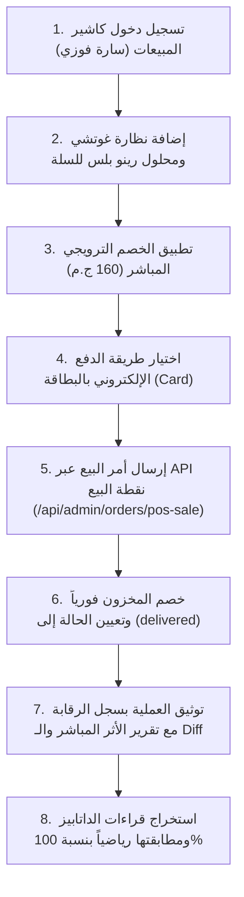

# وثيقة خطة الاختبار الشاملة — القالب الثالث (Template 3 Test Plan)
## مبيعات تجزئة فورية وسداد إلكتروني عبر بطاقة دفع (POS Direct Sale & Card Settlement)

---

### 1. الهدف والغاية التشغيلية (Objective)
اختبار دورة مبيعات التجزئة السريعة من الرف المباشر لنظارات شمسية ومحاليل عناية دون الحاجة لأمر تشغيل أو ورشة معمل خارجية، والتحقق من:
1. تطبيق خصم ترويجي مباشر على الفاتورة.
2. السداد الإلكتروني الفوري بنسبة 100% عبر بطاقة دفع بنكية (`card`).
3. الخصم الفوري والمباشر من أرصدة المخزون بالمحل لحظة إصدار الفاتورة.
4. عدم فتح أوامر تشغيل في قسم الورش والمعامل (`isLabOrder = false`).
5. قيد الإيراد وحساب مجمل الربح في الدفتر التجاري.
6. توثيق العملية فورياً في سجل الرقابة واللوجز الموحد (`auditlogs`) وتوليد بطاقة الأثر والتحول الرقمي التفصيلي.

---

### 2. أطراف السيناريو والموظفون المشاركون (Actors & Roles)

| الدور التشغيلي | اسم الموظف / العميل | البريد الإلكتروني | الصلاحية / الصفة |
| :--- | :--- | :--- | :--- |
| **كاشير ومسؤول المبيعات** | سارة عبد الرحمن فوزي | `sara.sales@optics.local` | كاشير الفرع ومسؤولة نقاط البيع (Role 3) |
| **العميل المشتري** | سارة إبراهيم الدسوقي | `01099887766` | عميلة متجر مسجلة حديثاً |
| **الفرع المنفذ** | فرع الدقي الرئيسي | `OPT-MAIN` | الفرع التشغيلي المباشر |

---

### 3. بنود الفاتورة والأسعار (Invoice Line Items)

| م | اسم الصنف / المنتج | الفئة | الكمية | سعر البيع الرسمي | تكلفة الشراء (Cost) | الإجمالي قبل الخصم |
| :-: | :--- | :---: | :-: | :-: | :-: | :-: |
| **1** | نظارة غوتشي كات آي حريمي أسيتات فاخر (Gucci GG0010S) | نظارات شمسية | 1 | 3,600.00 ج.م | 2,400.00 ج.م | 3,600.00 ج.م |
| **2** | محلول تعقيم وحفظ العدسات اللاصقة رينو بلس 360 مل | محاليل وعناية | 1 | 160.00 ج.م | 110.00 ج.م | 160.00 ج.م |
| **—** | **إجمالي الفاتورة الأساسي (Subtotal)** | — | **2** | — | **2,510.00 ج.م** | **3,760.00 ج.م** |
| **—** | **خصم ترويجي مباشر (Direct Discount)** | — | — | — | — | **-160.00 ج.م** |
| **—** | **الصافي المطلوب سداده (Final Order Total)** | — | — | — | — | **3,600.00 ج.م** |
| **—** | **المدفوع إلكترونياً (Card Settlement)** | بطاقة دفع | — | — | — | **3,600.00 ج.م** (100%) |
| **—** | **المتبقي على العميل (Remaining Balance)** | — | — | — | — | **0.00 ج.م** (خالص) |

---

### 4. مراحل سير العملية التقنية (Execution Steps)

